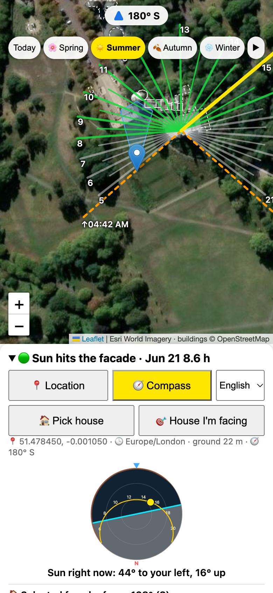

# SunPeek

**→ [sunpeek.uk](https://sunpeek.uk)**

**How much direct sun does this wall get?** Search an address or tap a building wall on the map, and SunPeek tells you how many hours of direct sun it gets today, at midsummer and at midwinter, with the exact time windows and a confidence range. It is built for house hunting: *does that balcony get afternoon sun in winter?*



## What you get

- **The answer first:** today / summer / winter hours as big tiles, the time windows below, and a **confidence chip** ("Confidence: medium · 4 h 56 m – 7 h 53 m"). Tap it to see the range for each day and what was assumed.
- **Your floor, front and centre.** The selected wall (direction and address) and the floor picker sit above the result; floor 0 reads "ground floor". SunPeek also finds the **first floor with no shadow from other buildings**, so it tells you when a higher floor would make no difference.
- **Rays with a key:** green and red hourly rays from the wall, with a small "sun reaches / building blocks" key on the map.
- **Shadows you can see:** a map layer draws every building's shadow at the selected time; the buildings that shade the selected wall during the day are outlined red, the one shading it right now is filled.
- **Seasons and time:** season buttons (hemisphere-aware), a time slider, a day animation, and the sky plot with the sun's path, the horizon and the wall.
- **Search or tap:** address search (or `lat, lon`); searching picks the building and its most sun-facing long wall automatically. Links of the form `https://sunpeek.uk/?at=57.6889,11.9223` open straight on that wall.
- **Listing links:** paste a listing link (Hemnet, Funda, Boligsiden and other sites that keep the street in the URL) and the address is read from the link itself; the listing page is never fetched. Links that only carry an id get a short "paste the address instead" note.
- **Share and PDF:** *Share* sends a link that opens the same wall and floor (`?at=lat,lon&az=direction&f=floor`) through the phone's share menu or the clipboard; *Save as PDF* prints the map and the result with the link, date and limits.
- **Where the sun is now:** a small sun at the map's edge shows the sun's real direction and height for the selected place right now; it moves when the map turns and can be switched off under *More*.
- **Trees, first step:** trees and wooded areas from OpenStreetMap within 30 m on the sunny side of the wall are shown on the map and as a warning; they are not in the calculation yet, so they cap the confidence at medium.
- **Sun check:** when you stand within ~150 m of the selected wall while the sun is on its side, a small row asks whether the wall has sun right now. Answers (anonymous, ~10 m position, kept 2 years) are compared with the model's estimate to measure real-world accuracy.
- **Phone compass:** the map rotates with the phone, and a "house I'm facing" picker finds the wall in front of you.
- **Solar energy (optional, folded away):** angle of incidence, clear-sky energy per m², and a conservative yearly range per installed kWp from three years of measured sunshine, including the share of an average EU household's electricity.
- **Honest about uncertainty:** a warning when most nearby building heights are unknown, the confidence range above, and short notes kept in (i) tips so the screen stays light.
- **Local time of the place**, 12/24-hour setting, six languages (English, Svenska, Türkçe, Deutsch, Español, Français), light and dark mode.

## How it works

The calculation runs in the browser; a small shared cache on the server makes data arrive faster for everyone.

| What | Source (primary → backup) |
|---|---|
| Sun position, sunrise/sunset | NOAA solar algorithm with Bennett refraction (`sun.js`) |
| Buildings | SunPeek shared cache → OpenStreetMap via Overpass (mirrors) → Overture Maps building tiles |
| Ground elevation, distant hills | SunPeek cache → AWS Terrain Tiles (terrarium) → Open-Meteo (Copernicus GLO-90) |
| Time zone of the place | embedded [tz-lookup](https://github.com/photostructure/tz-lookup) (no request) → Open-Meteo |
| Address search / address of a saved wall | SunPeek cache (Photon by komoot, Nominatim as backup through one rate-limited queue) → Photon directly if the server is down |
| Yearly sunshine for the solar estimate | SunPeek cache → Open-Meteo archive (3 years) |
| Imagery / map | Esri World Imagery, Leaflet + leaflet-rotate |
| Icons | [Lucide](https://lucide.dev) (ISC), inlined |

**Shadows.** A wall is in a building's shadow when the sun ray from the window enters that building below its top: `distance × tan(sun elevation) < height + base elevation − window height` (above any `min_height`). Only buildings in front of the wall within 600 m are considered, using their nearest corner. A wall is in terrain shadow when the sun is below the horizon profile (600 m – 8 km, Earth curvature and refraction included). The sun counts as on the wall while it is less than 90° off the wall's normal. Sunlight windows are found on a 5-minute grid and every sun/shade transition is then refined to about 20 seconds.

**Building heights.** Measured `height` first, then `building:levels` × 3 m (or the building's own storey height when both are tagged), then the median of nearby buildings of the same type (at least three, never lowering apartments below their default), then a type default. `building:part` replaces its outline only when the parts cover most of it.

**Confidence.** One level, set by the weakest of three factors, each listed in the confidence card:
1. *Height sensitivity:* the lowest and highest direct sun when all surrounding buildings sit at the low or the high edge of their height uncertainty, with the window 0.5 m lower or higher; the nominal result is always inside. High if the range is under ~30 min wide (100 × (1 − range / 2 h) ≥ 75), medium ≥ 45.
2. *Height data of the shading buildings:* if more than half of today's shade comes from buildings with estimated (untagged) heights, at most medium.
3. *Data source:* the backup source (Overture) can draw different outlines and even pick a different wall, so at most medium; the page switches to OpenStreetMap when the shared cache has fetched it.

The height edges are calibrated, not guessed. In 9 European cities we hid OSM height tags and re-estimated them; the bounds are the p10–p90 of true/estimate per source: tagged height ±1.5 m; from floors −10 % / +55 % (3 m per floor + 1 m mostly underestimates the tagged ridge height, but raising it made the hourly rays *less* accurate, because a pitched roof shades from its eaves); neighbourhood median −30 % / +120 %; type default −35 % / +150 %. Small untyped structures under 30 m² (sheds, garages) are 4 m, not the neighbourhood median: tagged ones have median 4 m, the median rule gave them 13–15 m. In the same hold-out test the true result fell inside the range 96 % of the time with height tags hidden, 88 % with heights and floors hidden, and 99 % with half of all tags hidden; 96 % of hourly rays had the right colour. It measures stability against our data, not the chance of being right: **trees and buildings missing from the map are not included.**

## Data, storage and privacy

- **On your device:** history and settings (localStorage); map data in IndexedDB — building cells (~550 m) 90 days, terrain tiles one year; stale data is shown at once and refreshed in the background.
- **SunPeek's shared cache (server):** receives only what is needed to fetch map data — area cell ids (~550 m), map tile numbers, the ~10 km cell for sunshine data, your search text and, for saved walls, the wall's coordinates to look up its address. It stores what it fetched: buildings 90 days, terrain 1 year, sunshine data 400 days, Overture tiles 60 days, **searches 30 days, addresses 90 days**. **No IP address, account or history is stored**, and the server never accepts data from browsers, so the cache cannot be poisoned. Questions or deletion requests: [issues](https://github.com/tbelbek/sunpeek/issues).
- **Analytics:** only with opt-in consent (asked on the first visit, changeable under *More › Visit statistics*), Cloudflare Web Analytics counts page views with country, browser and referring site; no cookies, no exact location. Without consent the script is never loaded. Cloudflare's automatic injection must stay off in the dashboard. Privacy and terms: [privacy.html](privacy.html), [terms.html](terms.html). Cloudflare also carries all traffic to sunpeek.uk.
- **Third parties:** if the cache cannot answer, the browser asks the sources above directly (never Nominatim: its one-request-per-second rule is kept in the server's single queue). The data card in the app (*More › SunPeek cache …*) shows every service and how many requests went to each.

## Accuracy and limits

- **Building heights are the main source of error.** OSM height coverage within 400 m, measured October 2026: Stockholm Södermalm 93 %, Berlin Prenzlauer Berg 83 %, Madrid Chamberí 31 %, Malmö 26 %, Valencia 21 %, Barcelona Eixample 14 %, İstanbul Kadıköy 6 %, İzmir Karşıyaka 0.2 %. Overture Maps adds heights in some places. Adding `building:levels` in OpenStreetMap improves results for everyone.
- **Trees, balconies, eaves and roof shapes are not modelled** (buildings are flat-topped prisms).
- Terrain tiles are bare earth at ~15 m (near) and ~60 m (far); hills closer than 600 m come from the ground grid.
- Phone compasses can be off by 10–15° near steel and concrete; GPS altitude by 10–30 m, so the floor estimate is only a suggestion.

## Run it

```sh
python3 -m http.server 8765                 # the app alone (no shared cache; falls back to the sources directly)
# full stack: web + cache API + PostgreSQL, test hook on, http://localhost:8090/?e2e
docker network create proxy_network 2>/dev/null
PG_PASSWORD=test docker compose -f docker-compose.yml -f docker-compose.e2e.yml up -d --build
```

Production uses `docker-compose.yml` alone: `sunpeek` (nginx-unprivileged, static files, `/api/` proxied), `sunpeek-api` (Node 22, `api/server.js`), `sunpeek-db` (PostgreSQL 17 on an internal network, named volume) and `sunpeek-probe` (checks every data source every 10 minutes and logs failures). Database migrations are versioned SQL files in `api/migrations`, applied in order at start-up. All containers run read-only where possible, with `cap_drop: ALL` and `no-new-privileges`; nginx sends a strict CSP and security headers, rate-limits `/api/` per visitor and keeps no access log for it.

The static pages are also served from Cloudflare Workers (`wrangler.toml`, static assets only, headers in `_headers`), so the page opens even when the server is down; build the bundle with `docker buildx build --target static -o dist .` and deploy it with `npx wrangler deploy`. Routes for `/api/*` have no Worker, so API calls go straight through the tunnel to nginx and keep the visitor's IP for rate limiting.

## Tests

```sh
node test.mjs                                   # math, shadows, heights, confidence, time zones, i18n
(cd api && DATABASE_URL=postgres://… node test.mjs)  # cache API against a real PostgreSQL and fake upstreams
sh e2e/smoke.sh                                 # headless Chrome: the app loads, places a point and draws
# end-to-end: open http://localhost:8090/?e2e in a browser, add <script src=/e2e/run.js>, then
#   await E2E_LOAD(); for (const n of E2E.names) console.log(n, await E2E.run(n))
```

The unit tests check the sun position against an independent NOAA implementation and published sunrise times, shadow and terrain logic, refined transition times (±30 s against a one-second scan), confidence ranges, building parts and `min_height`, the PMTiles tile ids and every language for missing keys. The end-to-end suite (22 scenarios) drives the real app: search and tapping, floors, seasons and polar night, compass, confidence card, history, offline and backup sources, the data card, languages, `?at=` links and the desktop layout. The deploy script runs the unit and smoke tests first.

## License

The SunPeek source code: all rights reserved; it is published for reference. Contact the author for any other use. This applies only to the code, not to the third-party data and services below, which keep their own licences.

Third-party: icons from [Lucide](https://lucide.dev) — ISC License. Time-zone lookup from [@photostructure/tz-lookup](https://github.com/photostructure/tz-lookup) — CC0. Map data © [OpenStreetMap contributors](https://www.openstreetmap.org/copyright) (ODbL); © [Overture Maps Foundation](https://docs.overturemaps.org/attribution/) (ODbL, with the source credits listed there). Imagery: Powered by Esri — Esri, Vantor, GeoEye, Earthstar Geographics, CNES/Airbus DS, USDA, USGS, AeroGRID, IGN and the GIS User Community (Esri World Imagery through the metered `ibasemaps-api` endpoint with an ArcGIS Location Platform API key, `ESRI_KEY` in app.js, restricted to the site's referrer). Terrain: [AWS Terrain Tiles](https://github.com/tilezen/joerd/blob/master/docs/attribution.md). Sunshine and elevation data: [Open-Meteo](https://open-meteo.com) (CC BY 4.0).
